<div align="center">

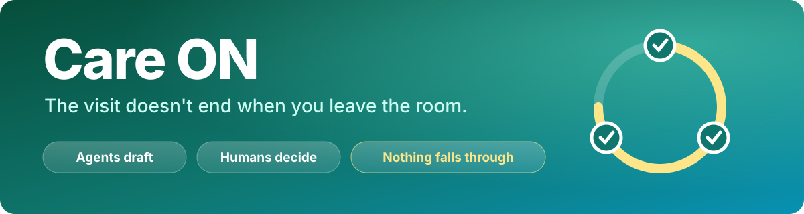

<br/>

**A multi-agent platform that follows a patient from "the visit ended" to "the medicine is in hand", and catches whatever falls through on the way.**

<br/>

[](https://straightto.health/demo/stage)
[](https://mlh.io)
[](#-what-keeps-it-safe)


</div>

---

## 💡 What is Care ON?

Most of care happens **after** the appointment. The doctor writes a plan, a prescription goes to a pharmacy, the patient goes home, and then nobody sees the whole picture. The pharmacy is delayed and nobody tells the patient. A pharmacy question sits unanswered. A patient has a question at 9 pm and no one to ask.

Care ON gives the patient, the doctor and the pharmacy **one shared, auditable timeline**, and puts a small team of AI agents on top of it. The agents **investigate, draft and check each other's work. A human always decides.**

> 🧭 **In one picture:** a visit status bar for the patient, a "your next action" board for the doctor, and a live log that shows exactly what every agent did and why.

---

## 🎬 See it in action

> Recorded from the real running product (real models, no mock-ups). The three windows are the doctor, the patient and the pharmacy simulator, side by side on the **Demo stage**, with the live agent log on the right.

### The whole care cycle, with the agents working
<p align="center">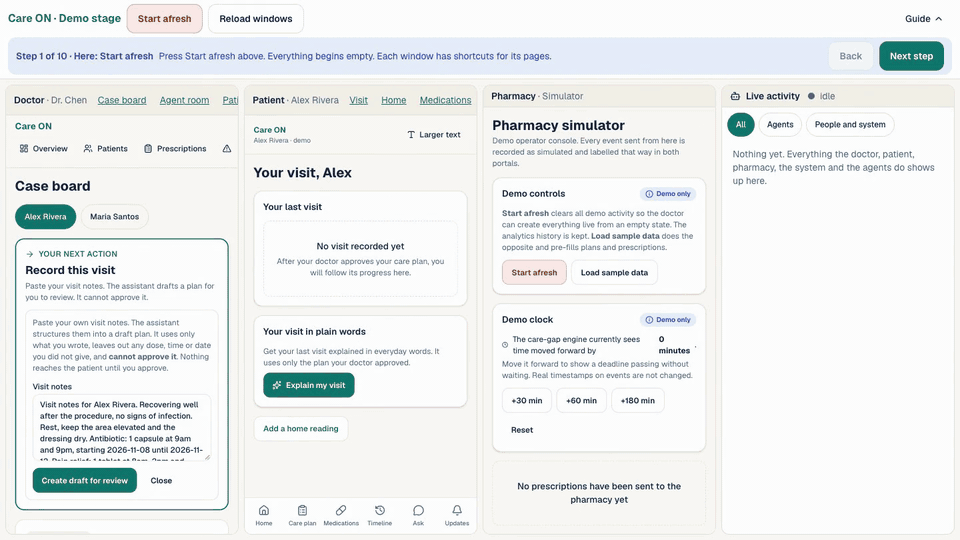</p>

<table>
<tr>
<td width="50%" valign="top">

### 📈 Home readings, with a range the doctor sets
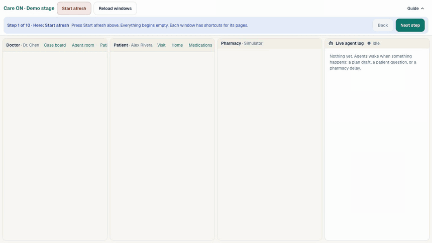

The app **describes** change in plain words ("up 5 bpm from the previous reading"). It never calls a value normal or serious, and it flags only what is outside a range **the clinician** chose.

</td>
<td width="50%" valign="top">

### 🛡️ Safety gates that don't depend on the model
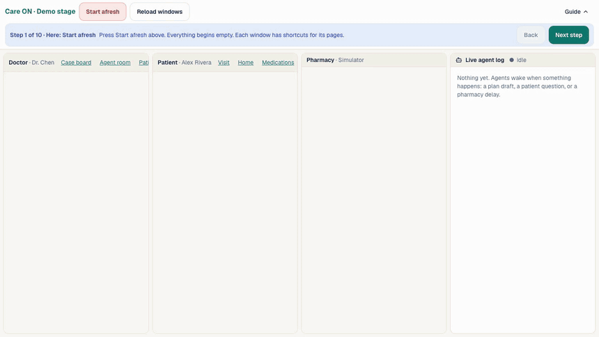

"I have chest pain" and "Is it okay to stop my antibiotic?" are caught **in code**, before any model is called, and sent to humans.

</td>
</tr>
</table>

<details>
<summary><b>🖼️ More screens</b></summary>

<br/>

| Doctor: agents' proposal for review | Patient: last-visit status bar |
|---|---|
| 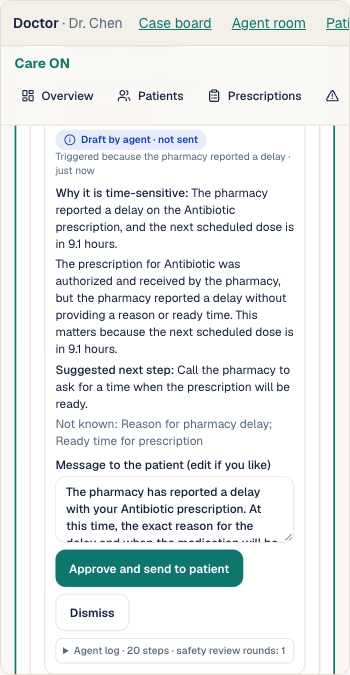 | 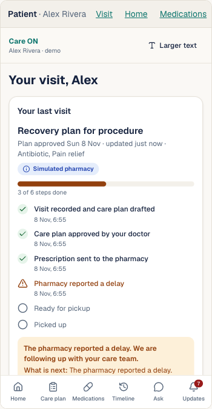 |

| Live agent log | Agent room |
|---|---|
| 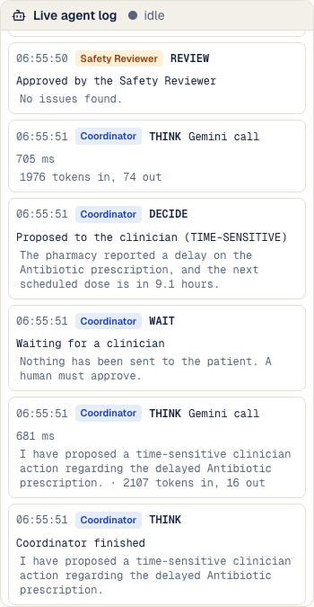 | 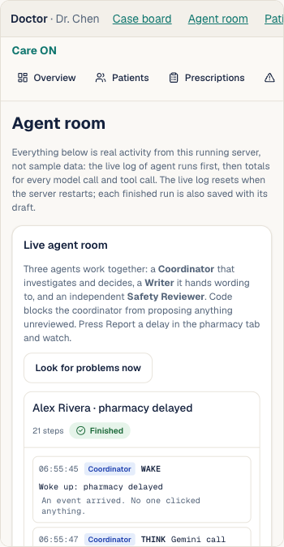 |

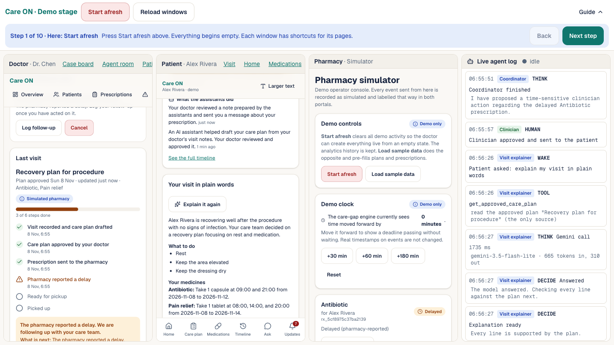

</details>

---

## ✨ Features

| | Feature | What it does |
|---|---|---|
| 🧭 | **Visit status bar** | The patient's home shows one bar for the whole visit: plan, prescription, pharmacy, pickup. What is happening now, what is next, and what the assistants did, in plain words. |
| 🎯 | **Doctor Case board** | One patient, one **"Your next action"** at a time: record the visit, approve the plan, send a prescription, review the agents' proposal, answer a question. No hunting through tabs. |
| 🤖 | **Care Coordinator** | Wakes by itself when the pharmacy reports a delay, a question or a rejection. Investigates with read-only tools, decides how urgent it is, and proposes. |
| ✍️ | **Writer + Safety Reviewer** | The Coordinator hands wording to a Writer. An independent Reviewer and code checks reject invented times, advice and reassurance. |
| 📜 | **Live agent log** | Every model call, tool call, hand-off, rejection and human decision, timestamped, in a dock on every doctor page and a column on the Stage. |
| 💬 | **Patient assistant** | Answers only from the patient's approved plan through permissioned tools. Clinical questions go to a human. |
| 📖 | **Visit Explainer** | Turns the approved plan into everyday words with a glossary. Every line is checked in code against the plan; unsupported lines are removed. |
| ❤️ | **Home readings** | Patient-reported heart rate, blood pressure, pain and temperature, with plain-word trends and clinician-set ranges. |
| ⏱️ | **Care-gap engine** | A deterministic engine notices when an expected step has not happened by its deadline. Administrative only, never a clinical finding. |
| 🏪 | **Pharmacy simulator** | Send simulated pharmacy events and move a demo clock forward to show deadlines passing. Everything is labelled simulated. |
| 📝 | **AI plan drafts** | Paste visit notes; the assistant drafts a plan. It cannot approve it, and any dose, time or date you did not write is stripped. |
| 🔁 | **Model fallback** | Gemini first; Amazon Bedrock takes over if Gemini is rate limited or failing. The model name in the log shows which one answered. |
| 📊 | **Time-series analytics** | Hypertables, continuous aggregates and compression on Tiger Data. |
| ♿ | **Responsive and accessible** | Phone, tablet and desktop layouts, large tap targets, axe accessibility scan with zero violations at last run. |

---

## 🤖 How the agents work

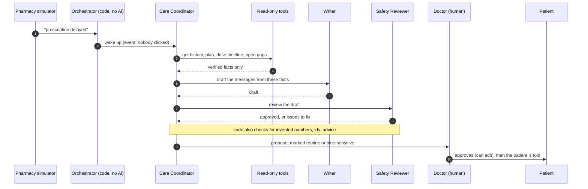

### 🔒 What keeps it safe

These rules are **enforced in code**. A model cannot talk its way around them.

- 🧑‍⚕️ **Human authority.** Agents have a role that no clinical transition accepts. They can only append drafts. A clinician approves, edits or dismisses.
- 🚧 **No unreviewed proposals.** The Coordinator's `propose_actions` is refused unless the current draft passed the safety review.
- ⏳ **No made-up urgency.** "Time-sensitive" is refused unless the dose timeline shows the same medicine due within 24 hours.
- 🚑 **Urgent symptoms bypass the model** and go straight to the care team.
- 💊 **Questions about stopping, skipping or changing a medicine** are forwarded to the care team by code, without calling the model.
- 🧪 **Grounded text only.** Drafts and explanations are checked against the source: no invented numbers, ids, timestamps, advice or reassurance.
- ❓ **Nothing invented.** Unknown stays unknown. An unanswered dose is "unconfirmed", never "missed". Reminders never invent a dose or time.
- 🏷️ **Honest labels.** Every fact carries who said it and whether it is confirmed, patient-reported, estimated or unverified. Simulated data is always labelled.

---

## 🏗️ Architecture

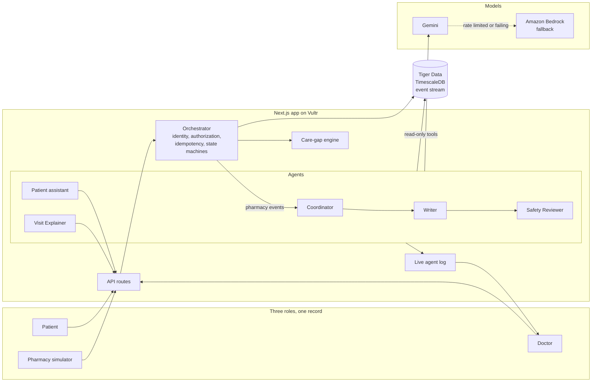

### 🧱 Design in one paragraph
Everything that happens is an **event** with an actor, a source, a verification category and a simulation flag. A deterministic **orchestrator** (not an LLM) validates identity, per-patient authorization and idempotency, and applies explicit **state machines** for prescriptions, care plans, tasks, clarifications and care gaps. Every screen is derived from the same events, so the patient and doctor views cannot disagree.

### 🧰 Stack

| Layer | Technology |
|---|---|
| App | Next.js 16 (App Router), React 19, TypeScript, Tailwind v4, Zod 4, TanStack Query |
| Agents | Google Gemini (function calling, structured output), Amazon Bedrock (Converse API) as fallback |
| Data | Tiger Data (TimescaleDB 2.31): hypertables, continuous aggregates, compression, zero-copy forks |
| Hosting | Vultr Cloud Compute, Caddy (automatic HTTPS), systemd |
| Quality | Vitest, Playwright (real Chrome), axe-core |

---

## 🐯 Tiger Data in the architecture

The event stream lives in Tiger Data (TimescaleDB). Numbers below were **measured** on the real service.

| What | Result |
|---|---|
| Schema | 4 hypertables, 5 real-time continuous aggregates, compression policy on the event table, retention only on agent logs |
| Scale tested | **548,461** synthetic events (60,000 prescription lifecycles, clearly flagged and hidden from the app) |
| Compression | 179.2 MB → 19.3 MB on compressed chunks (**9.3×**) |
| Continuous aggregate vs raw rows | 5.5 ms vs 67.8 ms server-side (**12.3×**), identical results |
| Safe migrations | Migrations and a 548k-event load were tested on a **zero-copy fork** before the real service. That found a real slow read, fixed by a partial index (21.7 ms → 3.8 ms). |

Synthetic history feeds analytics only. Live demo data is separate and can be cleared with **Start afresh**.

---

## 🚀 Run it yourself

### Prerequisites
- **Node 22+** and **pnpm**
- A **Gemini API key** (free tier works) from Google AI Studio
- *Optional:* a Tiger Data (or any Postgres) connection string, and AWS keys for the Bedrock fallback
- Chrome, if you want to run the browser tests

### 1. Install and configure
```bash
git clone https://github.com/VedantKhairnar/careos.git
cd careos
pnpm install
cp .env.example .env.local     # then fill it in
```

| Variable | Needed | What it is |
|---|---|---|
| `APPLICATION_SECRET` | production | Signs demo session cookies. `openssl rand -hex 32` |
| `APP_BASE_URL` | yes | The public URL, for example `http://localhost:3000`. If it starts with `https://`, cookies are marked Secure. |
| `DEMO_MODE` | for the demo | `true` enables the role switcher, Demo stage, pharmacy simulator and demo clock. **Never enable for real patient data.** |
| `GEMINI_API_KEY` | yes (for agents) | Google AI Studio key. Server side only. |
| `DATABASE_URL` | optional | Postgres/TimescaleDB. Without it the app runs on an in-memory store. |
| `AWS_ACCESS_KEY_ID`, `AWS_SECRET_ACCESS_KEY`, `AWS_REGION`, `BEDROCK_MODEL` | optional | Turns on the Bedrock fallback. Needs model access enabled in the Bedrock console. |
| `GEMINI_MODEL` | optional | Comma-separated model list to override the default |

### 2. Start it
```bash
# For a demo, use production mode (stable, no hot-reload):
pnpm build
pnpm start                 # http://localhost:3000

# For development:
pnpm dev
```
> No database? Add `CAREOS_STORE=memory` to run on a throwaway in-memory store.

### 3. Open the Demo stage
Go to **`/demo/stage`**. It signs in the doctor, the patient and the pharmacy at once and shows them side by side with the live agent log.

1. Press **Start afresh**.
2. **Doctor:** the board says "Record this visit". The notes are pre-filled, so press *Create draft for review*, then tick the box and *Approve care plan*.
3. **Doctor:** "Send a prescription". The medicine is pre-filled from the plan, so press *Authorize prescription*.
4. **Pharmacy:** *Receive*, *Acknowledge*, then **Report a delay**.
5. Watch the **log column**: the Coordinator wakes, investigates, hands off to the Writer, gets reviewed, and proposes.
6. **Doctor:** "Review what the agents prepared". Approve it. The patient's status bar and Updates show the message.

### 4. Optional: Tiger Data
```bash
pnpm db:migrate                                                    # applies db/migrations
node --env-file=.env.local --import tsx scripts/seed-history.ts    # synthetic history for analytics
node --env-file=.env.local --import tsx scripts/bench.ts           # measure aggregates vs raw rows
```

### 5. Test it
```bash
pnpm typecheck && pnpm lint
pnpm test                                       # 140 unit and API tests (memory store, scripted model)

# 9 database integration tests, in a throwaway schema:
set -a; . ./.env.local; set +a; CAREOS_TEST_DB=1 pnpm exec vitest run tests/pg.test.ts

# Real-browser tests (real Chrome, real models). They use your API quota:
pnpm build && pnpm start &
E2E_BASE_URL=http://localhost:3000 pnpm exec playwright test
```

### Re-record the README media
```bash
CAREOS_STORE=memory APP_BASE_URL=http://localhost:3400 pnpm exec next start -p 3400
pnpm media          # needs Chrome and ffmpeg; makes about a dozen real model calls
```

---

## ☁️ Deploy on Vultr

The repository includes the exact scripts used for the live deployment, under [`infra/vultr/`](infra/vultr):

| Step | Script |
|---|---|
| Install Node 22 (checksum verified), pnpm, Caddy | `1-install-runtime.sh` |
| Create the app user, clone, install, build | `2-fetch-and-build.sh` |
| systemd service, automatic HTTPS, firewall, SSH hardening | `3-service-https-firewall.sh` |
| Redeploy the latest commit | `update.sh <server-ip>` |

Highlights: the app runs as an unprivileged user, its port is not reachable from the internet, SSH is key-only, Caddy obtains and renews the certificate, and the cloud API key never goes on the server. Full runbook: [`infra/vultr/README.md`](infra/vultr/README.md).

---

## 🗂️ Project structure

```text
src/
├─ agents/        coordinator, writer, safety reviewer, patient assistant, explainer, tools, live log, model layer (Gemini + Bedrock)
├─ domain/        event envelope, state machines, dose rules, care-gap engine
├─ server/        orchestrator, event stores (memory and Tiger Data), services, auth
├─ app/
│  ├─ api/        route handlers (events, plans, prescriptions, agents, readings, visit, ...)
│  ├─ doctor/     Case board, patients, prescriptions, care gaps, analytics, Agent room
│  ├─ patient/    visit status, plan, medicines, readings, timeline, Ask, updates
│  └─ demo/       Demo stage and pharmacy simulator
└─ components/    shared UI (status bar, case board, agent dock, log view, ...)
db/migrations/    Tiger Data schema (hypertables, aggregates, indexes)
infra/vultr/      deployment scripts and runbook
scripts/          migrate, seed history, benchmark, README media, rename helper
tests/            unit and API tests, database tests, real-browser tests
```

---

## ✅ Quality

- **140** unit and API tests, with a scripted model so nothing calls a real service
- **9** opt-in database integration tests on a throwaway schema
- Real-browser end-to-end tests in Chrome with real models: the full demo, the agents flow, the one-screen Stage, home readings, phone and tablet layouts
- An accessibility scan (axe, WCAG 2 A/AA) with a sanity test that proves the scanner really flags a bad page
- Bugs found by driving the real product, not just by reading code: raw internal codes shown to patients, a shared cookie across tabs, empty-string fields from a fallback model, and more

---

## 🧭 Roadmap

- Real pharmacy and EHR integrations in place of the simulator
- Real authentication and rate limiting (the demo uses signed demo sessions)
- Visit transcripts turned into plain-language guidance
- Appointment booking, caregiver sharing and notification delivery by text or email
- A dedicated Tiger Data aggregate for home readings
- Testing in Safari, Firefox and on real phones

---

## ⚠️ Important

Care ON is a **hackathon demonstration**. All people, medicines and pharmacy events are **fictional or simulated** and are labelled that way in the app. It is **not medical advice and not a medical device**, and it must not be used with real patient data. For anything urgent, contact a care team or your local emergency number.

---

## 🙌 Built with

Next.js · React · TypeScript · Tailwind CSS · Zod · Google Gemini · Amazon Bedrock · Tiger Data (TimescaleDB) · Vultr · Caddy · Playwright · Vitest. Built with Claude Code; [Entire](https://docs.entire.io/overview) is enabled in this repository for agent session capture.

<div align="center">

**Built by [Vedant Khairnar](https://github.com/VedantKhairnar) at RIT HACK.COMS 2026**

<sub>Agents draft. Humans decide. Nothing falls through.</sub>

</div>
